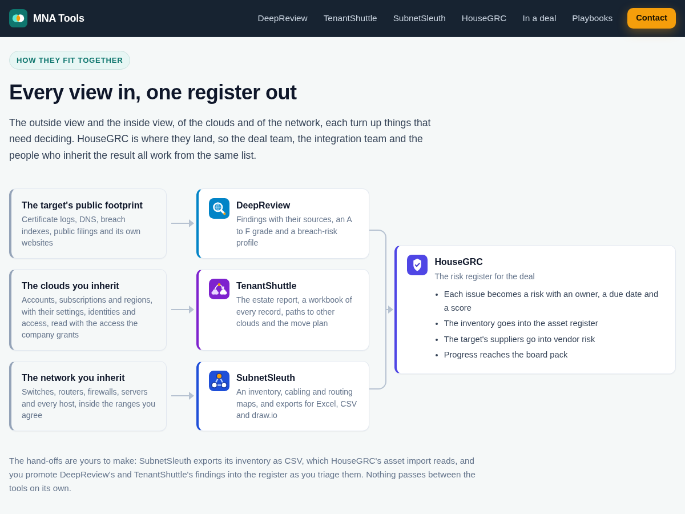
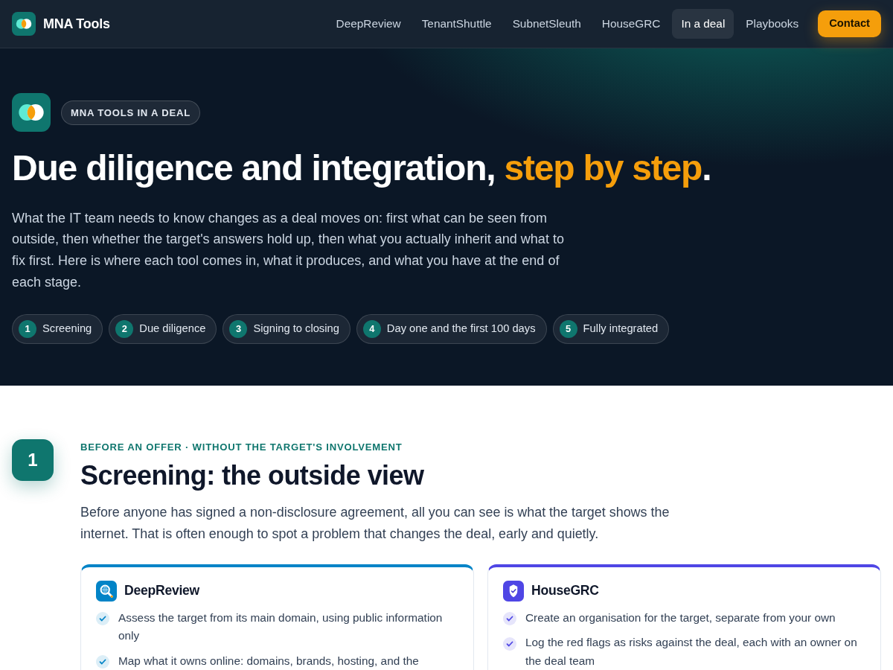

## What it is

The IT side of a deal comes in three parts: what the target looks like from outside, what you actually inherit inside, in its clouds and on its network, and the risks both turn up. Each part is usually done by hand, under time pressure, by people working on systems they do not own yet: a questionnaire nobody can check, a data room that lists the main subscription and the servers somebody remembered, a network diagram of how someone once meant it to be. [MNA Tools](https://mnatools.com) is a set of tools built for that work, one for each view of a deal.

## One view each

- **[DeepReview](/work/deepreview)** profiles the target from public information, the way an attacker would see it: every domain, brand and host it owns, including the ones nobody listed; exposed services, weak certificates, leaked credentials and known vulnerabilities, each with its source; and an A to F grade and a breach-risk profile for the deal team. It is the view before you sign, and it is free on request for organizations with a legitimate interest in the company.
- **[TenantShuttle](/work/tenantshuttle)** reads the clouds you are taking on, with access the company's own administrators grant: every account, subscription and region in scope, every setting, identity and grant, and what could not be read. It shows where each part of the estate could go, across nine destination clouds, and plans the move without taking over a name or merging an account that nobody approved. It is used from due diligence through integration, and it is free on request from [tenantshuttle.com](https://tenantshuttle.com).
- **[SubnetSleuth](/work/subnetsleuth)** inventories and maps the network you inherit, read-only and only inside the ranges you agree: every device and host with its model, serial number and software version, the cabling and routing maps nobody kept up to date, and what the firewalls, Active Directory and hypervisors already know. It is the day-one view, and it is free for any use from [subnetsleuth.com](https://subnetsleuth.com).
- **[HouseGRC](/work/housegrc)** is where everything the other views find lands: a risk register with owners, due dates and appetite, the target's suppliers assessed with their criticality and renewals, and the target's controls measured against the standards you hold yourself to. It stays in use until the last risk is closed, and it is free for any use from [housegrc.com](https://housegrc.com).

Each tool works on its own and keeps its own downloads, licenses and support; mnatools.com is the hub that shows how they fit together through a deal.

The hand-offs are deliberate and yours to make. SubnetSleuth exports its inventory as CSV, which HouseGRC's asset import reads, and you promote DeepReview's and TenantShuttle's findings into the register as you triage them. Nothing passes between the tools on its own.

## Built for work on someone else's systems

In a deal you are a guest on the target's systems until the day they become yours, so the tools share a few rules:

- **Inside the agreed scope.** SubnetSleuth contacts only the ranges you give it and never the ones you rule out. TenantShuttle reads only what the access the company's administrators grant allows. DeepReview works from public information unless an active check is switched on for an assessment.
- **Read-only.** SubnetSleuth reads devices with SNMP GET and never sets anything. TenantShuttle checks every request against a reviewed list of read operations before it is sent. Nothing changes a device, an account or a setting on the target's side.
- **A source for every claim.** Each DeepReview finding cites the public evidence behind it, and a lookup that failed is reported as failed, never as all clear. SubnetSleuth records where each fact about a host came from, and TenantShuttle lists what it could not read, with the reason.
- **Your data stays with you.** SubnetSleuth and TenantShuttle keep their projects on your computer, TenantShuttle's encrypted, and HouseGRC runs on your own server with its database encrypted. None of them sends what you record back to the vendor.

## In a deal, stage by stage

The site's [walkthrough](https://mnatools.com/in-a-deal) follows a deal through five stages and says, for each, what the IT team needs to know, which tool does what, what it produces, and what you should have at the end of the stage:

1. **Screening.** Profile the target from outside and log the red flags, before anyone has signed a non-disclosure agreement.
2. **Due diligence.** Test what the target tells you, read its clouds with the access it grants, and score what is wrong.
3. **Signing to closing.** Check that the promised fixes happened and get ready for day one.
4. **Day one and the first 100 days.** Know what you inherited, then fix it in the right order.
5. **Fully integrated.** Close out the register and keep the documentation true.

## Playbooks

Alongside the tools are seven [playbooks](https://mnatools.com/playbooks) for the technology side of a deal. They are vendor-neutral, written for the people doing the work, and they apply whether or not you use any of the tools:

- IT due diligence
- Security due diligence
- Day-one readiness
- The first 100 days
- Network integration
- Identity and email integration
- Carve-outs and transition services

Each is a general guide, not legal, tax or financial advice, meant to be adapted to the deal in front of you.

## The site

[mnatools.com](https://mnatools.com) is a static site on Cloudflare Pages, built from plain HTML and Markdown by a small Python script, with no forms, accounts, analytics or tracking. The product sites share its design: the same stylesheet, each in its own colour taken from the tool's mark. Before every deploy the build is checked: every internal link, anchor and image resolves, nothing a strict Content-Security-Policy would block, one heading per page, the sitemap is complete, and no page carries wording the site must not use, such as other vendors' product names. Every tool is designed, built and supported in New Brunswick, Canada.
