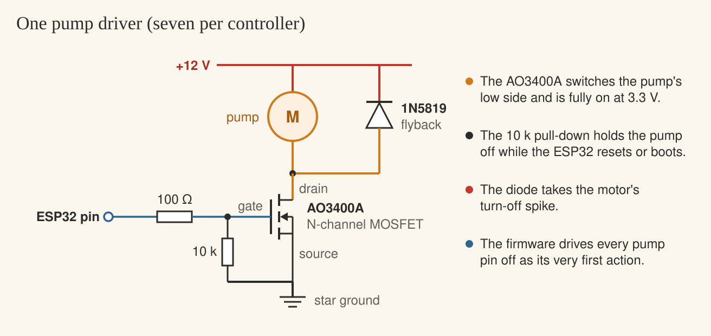

## What it is

PicoFarm is my hydroponics monitoring and control system. Each reservoir gets an ESP32 controller that measures pH, EC (how strong the nutrient solution is), water temperature and level, and runs seven pumps: pH Up, pH Down, Nutrient A and Nutrient B for dosing, plus refill, circulation and drain. A home server keeps the history, relays commands and sends push alerts, and an Android app shows everything and controls it from the phone.

It grew out of [PicoPH](/builds/picoph), the Raspberry Pi Pico monitor that has been watching the [garden](/garden/hydroponic-garden). PicoPH told me the pH and EC, but every correction was still done by hand: measure, add a little, wait, measure again. PicoFarm does that loop itself, for the reservoirs that feed the [printed towers](/builds/hydro-tower). A system that pumps acid, nutrients and water in a room of the house needs to be careful above all, so most of the design is about what it must never do.

It is a work in progress. The controller firmware is written and bench-tested; the sensors and pumps are being wired, and the server and the app are being built now.

## How it fits together

The controllers join the home Wi-Fi and talk MQTT to a broker on the home server. Each one publishes its readings every few seconds, plus events: a pump started or stopped, a command refused, an alarm raised or cleared. Commands and settings flow the other way. Each controller only has access to its own topics, and if one drops off the network the broker tells the server, which raises an offline alert.

The most important choice is where the decisions live. **Every safety rule and all the automation run on the controller.** The server records, relays and alerts, but it never decides anything that matters for safety: if it goes down, or the Wi-Fi does, each controller keeps measuring, keeps dosing within its limits and keeps every interlock. A command from the app is a request. The controller checks it against its own rules and either runs it or answers with the reason it refused, such as "blocked: low water".

Settings are versioned. A controller applies a new configuration only if it is newer than the one it has, stores it, and runs on it from then on. Controllers also don't hold on to commands while they're offline: a "run the drain pump" sent while a controller was unreachable is dropped, not carried out hours later.

## The controller

The controller is an ESP32 dev board (the firmware builds for the ESP32-WROOM-32 and the ESP32-S3) in an IP65 box with the sensor boards and seven pump drivers.

- **Analog sensors go through an ADS1115**, a 16-bit converter on I²C. The ESP32's own converter is noisy, and part of it stops working once Wi-Fi is on.
- **pH:** a pH-4502C board with a BNC probe. Its output swings up to 5 V, so a 10 k/20 k divider brings it under the ADS1115's limit.
- **EC:** an analog conductivity board and probe. An EC probe drives current through the water, which skews a pH probe in the same reservoir, so the board is powered from a GPIO and only switched on while EC is being read.
- **Water temperature:** a waterproof DS18B20. EC readings need it for compensation, and the pH maths uses it to correct the probe's slope; automatic EC dosing refuses to run without it.
- **Level:** an analog level sensor, or an ultrasonic JSN-SR04T looking down at the water from above.
- **Float switches** for low, high and emergency water, and a **leak sensor** on the floor. Each float is mounted so its contact is closed when things are normal, so a cut wire reads as the alarm and stops the pumps instead of hiding the fault.
- **Seven 12 V pumps**: four peristaltic pumps for the dosing, and three small pumps for refill, circulation and drain. Each one is switched on its low side by a logic-level MOSFET.

![The controller wiring: a 12 V supply through a 5 A fuse feeds the pump rail and a buck converter to 5 V; the ESP32-WROOM-32 reads an ADS1115 on GPIO21 and 22 (pH through a 10 k/20 k divider on A0, the EC board on A1 powered from GPIO13, analog level on A2), a DS18B20 on GPIO4 with a 4.7 k pull-up, floats on GPIO32, 33 and 25, a leak sensor on GPIO35 with a 10 k pull-up and an ultrasonic sensor on GPIO14 and 34 through a 1 k/2 k divider; GPIO16, 17, 18, 19, 23, 26 and 27 drive the seven pump MOSFETs, and the emergency float sits in the refill pump’s 12 V line](./wiring.svg)

A few things in that drawing are there for safety rather than function. The pump pins avoid the ESP32's strapping pins and the pins that pulse during boot, so a reset can't twitch a pump. Pump return current comes straight back to a single star ground point and stays off the sensor wiring, where it would disturb the readings. The 12 V rail has a fuse.

Each pump driver is the same small circuit. The AO3400A turns fully on at 3.3 V on its gate, so it runs cool straight from an ESP32 pin. The 10 k pull-down keeps the pump off while the ESP32 resets or boots, before the firmware has control of the pin, and the first thing the firmware does at boot is drive every pump pin off anyway. The diode catches the spike a motor throws when it switches off. A pump that runs on mains power instead goes through a rated relay in an enclosure, on a GFCI-protected circuit.

## The reservoir

The probes hang in the solution, the four dosing lines drip in from above, and the circulation pump mixes what arrives. The floats are placed for what each one protects:

- **Low float:** below it, dosing, circulation and drain are all blocked, so nothing is dosed into a nearly empty tank and no pump runs dry.
- **High float:** stops the refill.
- **Emergency float:** sits above the high float and is wired in series with the refill pump's 12 V supply. If the water ever reaches it, the refill pump loses power, whatever the firmware is doing. A second float at the same height reports the trip to the controller, which locks refill out until the alarm is cleared and shows it on the phone.
- **Leak sensor:** on the floor beside the tank. Wet means every pump stops, and they stay stopped until someone clears the alarm.

## How it decides

Automatic dosing works from a target and a band for each value (by default pH 5.9 ± 0.3 and EC 1.6 ± 0.2 mS/cm) and a dose size in millilitres. Each pump's flow rate is calibrated, so a dose in millilitres becomes an exact run time. The controller is deliberately patient:

- **It waits after every dose, refill and boot.** The default is a 10-minute mix, with circulation forced on after a dose, and then it needs a fresh reading taken after the mix before it may act again. Waiting after boot also means a controller stuck in a reboot loop can never dose.
- **EC comes before pH**, because adding nutrients moves the pH. pH is only corrected once EC is in band.
- **Nutrient B follows A after a gap** (60 seconds by default), so the two concentrates never meet undiluted. If A is cut short, B doesn't follow.
- **EC above the band only raises an alarm.** There is nothing to dose for that: the reservoir needs fresh water.
- **Automatic refill needs something to stop it**, either a level sensor or the high float, and won't run without one. If a refill runs for its maximum time without reaching the stop level, something is wrong (an empty supply, a stuck float), so it latches a `refill_timeout` alarm and stays off until cleared.
- **It won't guess.** Automatic mode refuses to run with an uncalibrated probe or pump, and says so as an alarm. A refused automatic action is retried at most once a minute.

## Layers of protection

1. **Hardware.** The emergency float cuts the refill pump's power, the gate pull-downs hold every pump off through a reset, and the 12 V rail is fused.
2. **Watchdog.** If the control loop stalls for 5 seconds, the chip resets and every pump stops.
3. **Interlocks.** A leak stops everything. Low water blocks dosing, circulation and drain. High water and the emergency float block refill. Drain and refill never run together, and neither do pH Up and pH Down. Manual commands from the app go through the same checks as the automation.
4. **Limits.** Each pump can have a maximum single run and a daily run-time cap, and the dosing and refill pumps have both by default. A manual refill with nothing to stop it is limited to 60 seconds.
5. **Patience.** The mix wait, the fresh reading, EC before pH and B after A, as above. The leak, emergency and refill-timeout alarms survive a reboot and clear only when someone clears them.

The control core is plain C++ with no hardware calls, so the same code runs on the controllers and on my computer. 36 unit tests cover it there: the interlocks, the limits, the dosing order, the calibration maths, alarms that survive a reboot, and edge cases such as losing the level sensor in the middle of a refill or the millisecond counter wrapping around after 49 days.

## The server

The server runs on a home machine: an MQTT broker for the controllers, and a Python FastAPI service that does everything else. It stores the readings in SQLite and serves them back as charts, keeps a log of events, and holds each controller's settings so that a change made while a controller is offline is applied when it reconnects. It also serves the web dashboard and the API the app uses.

Alerts are the server's other job. On top of the controllers' own alarms, it watches thresholds I set for each controller (pH, EC and temperature out of range, a low level, a controller offline for too long) and sends every warning and critical event to the phone through a self-hosted ntfy server. Nothing goes through an outside cloud service.

## The Android app

The app is how I'll use PicoFarm day to day, on the home network or from anywhere over a VPN. Its screens:

- **Live readings:** pH, EC, temperature and level for each controller, with its alarms.
- **Pumps:** manual control of each pump, and a STOP ALL button.
- **Control settings:** the automatic modes, targets and bands.
- **Guided calibration:** step-by-step calibration of the probes, with a stability indicator that shows when a reading has settled enough to store.
- **History:** charts of pH, EC, temperature and level over time.
- **Events:** doses, refusals, alarms and settings changes.
- **Push alerts:** warnings and critical events arrive as notifications.

## Status

- **Firmware:** builds for the ESP32-WROOM-32 and the ESP32-S3, and is bench-tested on a WROOM-32. It boots, opens its setup hotspot, answers console commands, and its interlocks refuse what they should. The 36 host tests pass.
- **Hardware:** the sensors and pump drivers are being wired.
- **Server and app:** being built now.

Next comes wiring it to a real reservoir, calibrating the probes, and watching the first automatic doses closely before I trust it alone.
