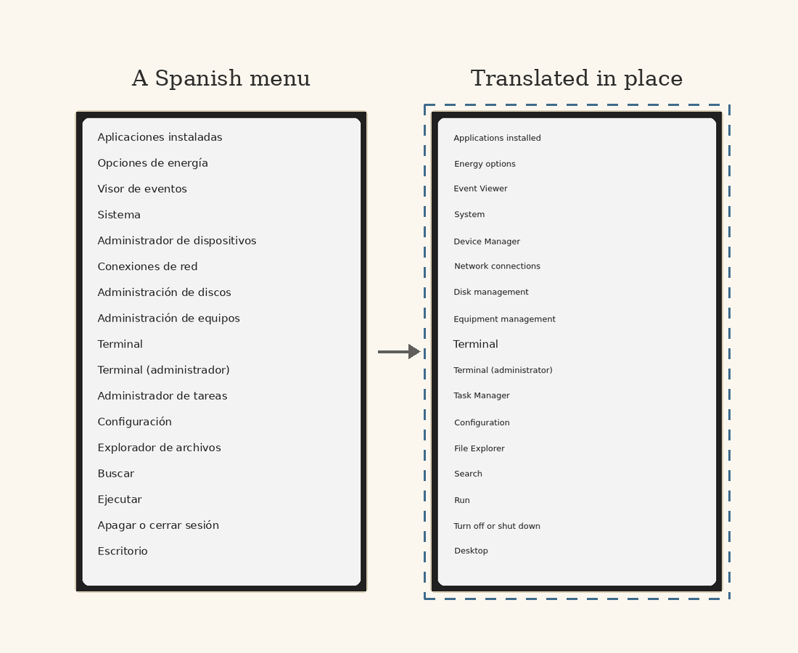

## What it is

Screenlate is a see-through window you put over something written in another language: a Spanish PDF, a game, a chat window, a settings page, a website. The text underneath is replaced with its translation in the same position, on the same background colour, sized to fit the space the original took. It's the camera mode of a phone translator, pointed at the desktop instead of the real world.

Two things define how it behaves.

**It's completely inert.** Clicks, scrolling and keystrokes all pass straight through to the application underneath, and it never takes focus, so you keep working with it sitting on top. It only ever draws. That's why it's driven from the tray icon and global hotkeys rather than by clicking it.

**It's portable.** There's no installer and nothing to set up: unzip the folder and run the executable. The Python runtime, Qt, the Tesseract OCR engine and the translation models all travel inside it, and with the local engine nothing leaves the machine and no network connection is used at any point.

## Using it

A setup window asks for the languages and the engine, then the overlay opens covering the screen, ready to be positioned: drag it over what you want translated, drag its edges to resize it, and press **Start translating**. From then on it is a ghost. `Ctrl+Alt+Space` makes it solid again to move it (which also pauses translation), and other hotkeys freeze the current translation, hide it, re-translate now, swap the direction, save a diagnostic snapshot and turn the keyboard fix on and off. If another application already owns a hotkey, a tray notification says which.

Eight language pairs work offline out of the box: Spanish, Dutch, German, French, Greek, Norwegian, Swedish and Portuguese, each to English. English to Spanish and Italian, Japanese, Chinese, Russian and Korean to English are each one download away in Settings. Settings and extra models are kept in a folder beside the executable, so the whole thing can be copied to another PC as it is.

The diagnostic snapshot exists for bug reports: it saves the exact pixels that were read, the same with the translations painted on, every box the OCR found and every patch that was painted, and the display's geometry and scaling, which replaces guessing about resolutions.

## How it reads a screen

The pipeline is capture, change detection, OCR, translation, layout and paint, and most of the work went into the details:

- **It doesn't capture itself.** The window is excluded from screen capture while staying visible to you. Without that it would read its own translated output, translate it again, and degrade a little on every pass.
- **It reads only a screen that has stopped moving.** Each frame is hashed after a hard downscale and OCR runs only once the hash holds steady, so scrolling doesn't trigger a read per frame. A region that never holds still, like a clock or a video, is read anyway every couple of seconds.
- **It reads twice and paints each pass as it lands.** The whole frame is read as it is, in under a second; at the same time an enlarged copy, cut into overlapping tiles, goes to the other cores to recover small text. Where both read the same place the better reading wins, and each tile is painted as it finishes, so most of the screen is translated within a second and the rest fills in. Enlargement is only ever by a whole number: a fractional resample smears small glyphs and read fewer labels than no enlargement at all.
- **It treats the screen as sparse text, not a document.** Tesseract's document layout analysis looks for columns of prose and quietly drops short, scattered labels, which are most of a settings page. Its sparse-text mode found 25 or 26 of 26 labels on a test settings page where document mode found 8 to 17.
- **It translates paragraphs but paints lines.** Wrapped lines are rejoined before translation, because a sentence translated line by line comes out mangled, but the result is painted back one tight patch per original line, so it never covers the gaps between lines or content that was never text.
- **It separates things the OCR lumped together.** Labels that merely share a row are split at gaps too wide to be word spaces, a context menu stops being one paragraph of unrelated items, and an icon read as a letter beside its label is dropped by looking at the pixels under it.
- **It samples the real colours.** Each line's background is the dominant colour inside its own box and the text colour is the pixel furthest from it, so a translation sits on a dark card in light text and on a light page in dark text without being told which is which.

Display scaling is handled throughout: the window is measured in Windows' scaled units, the screen is read in real pixels, and the overlay converts between the two.

## Offline translation, without the weight

The offline translation models are the open Argos Translate models, but not the Argos library: it pulls in a machine-learning framework and, through it, gigabytes of GPU libraries for a job done on the CPU. A model file is really a CTranslate2 model and a subword vocabulary, so Screenlate drives those two directly, with its own sentence splitter, and gets the same translations from a fraction of the size. The model runs unquantised on purpose: the faster 8-bit version measurably broke it, turning *Subtitulos activados* into "Retirees activated". Output that falls into a repetition loop is detected and the original text is left showing instead.

There's a second engine for the screens the local one can't read: Google Cloud Vision and Translation, with your own API key. The trade-off is plain: the local engine is free and private; the cloud one reads stylised and low-contrast text reliably, costs a little past the free tier, and sends the captured region to Google.

## The keyboard fix

The other cross-language nuisance is a keyboard whose keycaps disagree with the layout Windows has active: a Spanish keyboard on a machine set to US English types `&` for the key labelled `/`, has no `ñ`, and its accent keys type nothing. Pick the layout printed on your keys and turn on **Type what the keycaps say**, and every key types what's on it, in every application. Keys the two layouts agree on pass straight through; the ones they disagree on are replaced with the keycap's character; dead keys compose (`´` then `e` is `é`); and shortcuts follow the keycaps too, so `Ctrl+Z` on a German keyboard undoes. Fifteen layouts are built in, it needs no layout installed in Windows, it changes nothing on the machine, and it's off until you turn it on.

## Honest limits

The local engine can't read some text at all: on light-text-on-dark panels and stylised type, Tesseract returns partial words or nothing, and whatever it misses stays visible under the overlay. Text over photos and gradients reads poorly, the offline model is better on menus, signs and short prose than on idiom, and strongly slanted text is painted into its upright box.

It needs Windows 10 version 2004 or newer for the capture exclusion. The executable isn't code-signed, so Windows warns about it on first run, and with eight language pairs bundled the download is about a gigabyte. The keyboard fix's decision logic and its fifteen layout tables are tested against a simulated machine, a Spanish keyboard on a US system; the Windows keyboard hook itself hadn't yet been run on real hardware when it shipped.

## Closing

An overlay like this is only useful if you can forget it's there. Most of the engineering serves that: it never steals a click, it never paints over something that wasn't text, and when it can't read a line it leaves the original alone rather than guessing.
