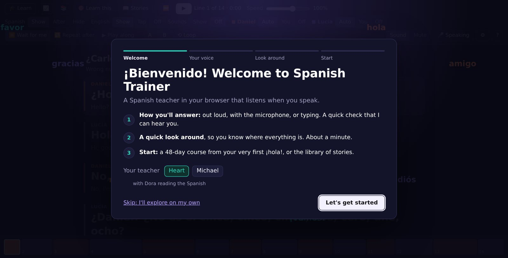
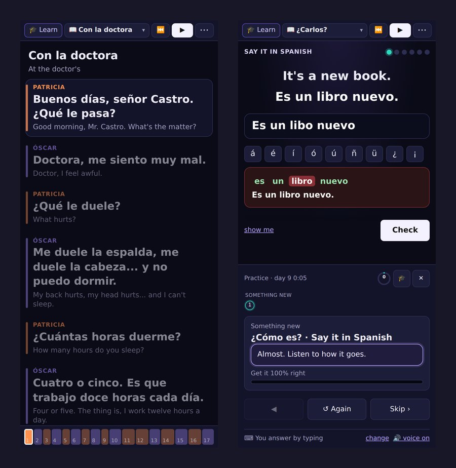

## What it is

Spanish Trainer is the language version of [Piano Trainer](/work/piano-trainer) and [Guitar Trainer](/work/guitar-trainer): a teacher in the browser that hears your answers, keeps you on each exercise until it's right, and helps when it isn't. It needs no account and nothing installed. Try it at **[language.jlwhite.ca](https://language.jlwhite.ca)**, or open it straight from a folder of files, offline (speech recognition is the one part that may need a connection, see below).

The Spanish is Latin American, as it's spoken from Mexico to Argentina: *ustedes* for "you all" and never *vosotros*, *seseo* in the voices, *carro*, *celular* and *computadora*.

## Getting started

The first visit opens a short welcome. It asks how you'd like to answer, checks that it can hear you if you chose to speak, shows you round the screen, and takes you into day one of the course or into the library. You choose your teacher there too: Heart or Michael, each paired with a Spanish voice (Dora or Alex) that says the Spanish.

There are three ways to answer, and you can switch at any time:

- **Speaking.** The browser's own speech recognition turns what you say into words, in Chrome, Edge, Safari and Chrome on Android. Answers are compared by sound, not spelling: the spellings a recogniser might pick for the same sounds (*hola* and *ola*, *vaca* and *baca*, and *casa* and *caza*, which sound alike in Latin America) all count, numbers it writes as digits are read as words, and the best of its guesses is used. What it heard is shown with each word of the answer marked right, wrong or missing.
- **Typing.** Every word is checked; case and punctuation never matter. A missing accent (*esta* for *está*, *ano* for *año*) counts as right but is pointed out, unless strict accents are turned on. The accented letters are buttons under the box, or typed as `a'`, `n~` and `u"`.
- **Say it, and check myself.** No microphone: say it out loud, hear it said, and tell the teacher how it went.

## The course

The course is 48 days over eight weeks, each day under an hour, from saying hello and spelling your name to the preterite and the imperfect, commands, *por* and *para*, and a graduation conversation. About 1,100 new words are taught along the way, a couple of dozen a day.

Every day has the same shape: a warm-up, a review of exercises that are due again, the day's new words, something new (explained by the teacher with examples, then practised), a conversation, a reading you've never seen with questions on it, a game, and *your turn*: the conversation again, without stopping. The last day of each week is a conversation day that ends with a conversation about you, in your own words.

The exercises are the ones a language teacher uses: what does it mean, build the sentence from tiles, say it in Spanish, read it aloud, repeat after me, write what you hear, fill the gap. The games are matching pairs, numbers, a one-minute verb sprint, echo, and *el or la?*.

As in the siblings, it keeps you on an exercise until it's 100% right, and the help escalates a step at a time: "nearly!", then slower voices, hints with the first letter of each word, just the sentences you missed until they're right, word tiles instead of writing, and after a while a break and the offer to skip it for now so it comes back in a review. A missed sentence is shown, said and asked again at the end of the run, but the score is what was right the first time.

Reviews bring exercises back before you forget them, at 1, 2, 4, 8 and 16 days, and sooner for one that needed help. **Learn this** does the same for anything in the library, a few lines at a time. Around it all there are XP, levels, badges, a daily goal and a streak, and **My words** lists every word you've met, how well you know it, and a quick quiz on the ones that are due.

## How it sounds

Spanish is said the way it's written, so the app works out every word's pronunciation from its spelling: its syllables with the strong one marked, a spelling an English speaker can read out, and its pronunciation in IPA. Tap any word, in the reader or in a lesson, and it says what the word is and what it means ("tengo: tener, to have; present, yo"), says it, slowly too, and gives a tip for each of its tricky sounds.

The tips cover the sounds English speakers find hard: the rolled r, the breathy j, ll said like y, the soft d, two vowels in one beat. In a lesson, a word that wasn't heard right is shown spelled out the same way, and the teacher says the tip for its trickiest sound. **The sounds of Spanish**, in Help, has every tip with words to hear.

## The reader and the library

The reader plays a conversation, a story or a poem a line at a time, each word lighting up as it's said, with the English underneath, a tap away, or off. You can take a part and say your lines when it waits for you, repeat every line after the voice, or keep going like a real conversation and be scored. It slows down without changing the voice, loops a few lines, and the strip along the bottom jumps to any line.

The library holds 6 first stories, 12 everyday conversations, 10 short stories, 6 fables retold, 20 sayings, 6 poems by Martí, Bécquer, Machado and Darío, and the openings of *Don Quijote*, *Platero y yo* and *Tres héroes*, plus the 96 conversations and readings of the course. Each one says from which day of the course you know its words, and a word only a classic uses has its meaning there.

## Every sentence checked against what's been taught

The course is written in a small notation, a week to a file, and built from it. The build knows every form of every word: the plural of a noun, the forms of an adjective, and every tense of a verb, irregular ones included (*tener*: tengo, tuve, tenía, tendré, tenga, ten), with stem changes (*quiero*, *puedo*, *pido*), spelling changes (*busqué*, *conozco*) and pronouns on the end (*levantándome*, *dímelo*). It also knows the day each word is taught and the day each tense is, and it stops on any sentence that uses a word or a tense before its day. So a lesson never asks you for something you haven't met, and the same dictionary is the one the app shows when you tap a word.

## The voices

Every line is pre-recorded with the Kokoro text-to-speech model running locally, more than twelve thousand clips in four voices. The teachers speak English, and the Spanish inside what they say ("To say hello, say *hola*") is spoken by the Spanish voice that goes with them, joined into one clip. Every Spanish sentence is recorded in both Spanish voices, pronounced as Latin American Spanish, and Whisper finds when each word starts so the reader can light the words up as they're said.

## Phones and tablets

On a small screen the toolbar is one row, the rest moves into a ⋯ panel, and a lesson's teacher sits under the exercise, or beside it with the phone on its side. The screen stays on during a lesson, and added to the home screen it opens like an app.

## Honest limits

Speech recognition is the browser's, not the app's. Chrome and Edge send what you say to Google's or Microsoft's speech service unless the browser can recognise it on the device, and Firefox has none at all, so there it's typing or checking yourself. On Android a page that holds the microphone leaves the recogniser hearing silence, so on phones the level meter follows the recogniser instead of opening the microphone itself. The tests drive every exercise through a stand-in recogniser, which proves the app's side but not how well a given browser hears a given accent.

The Spanish voices are synthetic. Sound by sound the pronunciation is right, but they don't yet sound as natural as a native speaker.

## Closing

The piano and guitar versions rest on hearing the instrument honestly. Here the instrument is your voice, and the hard part moved: not hearing the sound, which the browser does, but deciding fairly whether what it heard is what you meant to say, and making sure every sentence the course asks for is one you've actually been taught.
