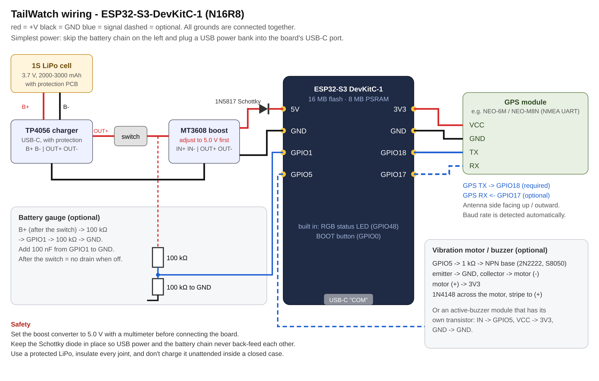

## What it is

Location trackers are small, cheap and built to be found by their owner's phone, which also makes them easy to slip into someone else's bag or car. Phones pass the test of "is this following me?" even more quietly. TailWatch is a pocket device and an Android app that answer that question from radio alone. The device listens to the 2.4 GHz Wi-Fi and Bluetooth traffic around you, the app keeps the history, and together they flag anything that keeps showing up in places you go and nobody else's.

Everything it does is passive. The device never transmits on Wi-Fi, and on Bluetooth it only talks to the phone it is paired with, over an encrypted link. What it hears stays on the device and the phone.

## What it looks for

- **Location trackers.** It recognizes the common tag families and the cross-vendor "unwanted tracking" beacon, and whether a tracker reports that its owner is away from it, which is the stalking case.
- **Something travelling with you.** Places are built from a GPS module or from the phone's location. A device heard at several of your places, kilometres apart and across days, is a follower. The device raises the alert on its own after three places at least 500 m apart; the app scores the whole history.
- **A tracker in a car.** A separated tracker heard continuously for ten minutes or more alerts even without a location fix.
- **Newcomers and regulars.** Each place learns the devices that are always there and only there. A device that recently appeared at a place you visit often, and keeps lingering, is a newcomer: a car parked outside, for example.
- **Drones.** Remote ID broadcasts over Bluetooth, Wi-Fi beacons and Wi-Fi NAN, and drones flown over their own Wi-Fi.
- **Wi-Fi attacks and camera hints.** Floods of deauthentication frames, access points answering to many different network names, and radios that look like camera hotspots (a hint, not proof).

Anything can be tagged *Mine* (never alert), *Watch* (alert whenever it is near) or *Ignore*, and the tags sync to the device so it stops alerting on your own phone, watch and earbuds too. A *Locate* screen turns any device into a hot-and-cold meter for physically finding it.

## How it works

**The device** is an ESP32-S3 with 8 MB of PSRAM. The firmware puts Wi-Fi into promiscuous mode and hops channels 1 to 13, reading beacons, probe requests, association and data frames to learn the access points, the clients and which network each client is using. Bluetooth is scanned passively, with tracker classification on the device. Devices are tracked in PSRAM, summarized every observation window (two minutes by default) together with the current location, scored on the device for follow and tracker alerts, written to a roughly 13 MB ring log in flash, and streamed to the phone. When the phone comes back after being out of range, it syncs whatever it missed.

**The link** is one Bluetooth service with LE Secure Connections bonding required: the device drops any connection that does not encrypt within a minute, and only accepts new bonds while a pairing window is open. Both directions carry newline-delimited JSON, and the same protocol runs over USB serial for testing.

**The app** is Kotlin and Compose. A foreground service holds the link, stores every window and observation in SQLite, clusters locations into places of about 200 m, and scores every device over the last 14 days. A setup checklist makes sure Android will actually let it run in a pocket (location "all the time", no battery restrictions, notifications), and a watchdog raises a banner and a notification if detection ever pauses.

**Pairing is deliberately narrow.** A sensor that stays pairable whenever it has no phone can be paired by any phone that happens to be nearby. So a new device opens a ten-minute window after power-on, a three-second press on its button reopens it for two minutes, and it remembers up to four phones.

## Following a device that changes its address

Phones and many gadgets randomize their Bluetooth and Wi-Fi addresses so they can't be followed from one place to the next. That privacy feature is exactly what a follower would hide behind.

TailWatch fingerprints the parts of each advertisement or Wi-Fi probe that don't rotate: the advertisement's structure, its name, service UUIDs and service-data UUID, company identifier, appearance and transmit power for Bluetooth; the ordered list of information elements, capabilities and vendor identifiers for a Wi-Fi probe (never the network name itself). The rotating payload bytes are left out.

The app then groups randomized addresses by fingerprint, on one rule: **if a fingerprint is never seen on two devices at the same time, every address that carried it belongs to one physical device.** That links the addresses even across long gaps, which matters, because a follower rotates its address between the places you stop. A fingerprint that does turn up on two devices at once is split, with low confidence. A fingerprint built only from a vendor or an appearance is too broad to link anything, so it isn't used. The first run on real hardware already showed two random addresses sharing one fingerprint.

There is an honest wall here: a device that rotates *every* field, as a modern iPhone does, cannot be linked passively. That is Apple's design. Separated trackers are the useful exception, because the anti-stalking standard makes them keep one address for a day, so they show up directly as trackers.

## More than one board

Several boards cooperate over ESP-NOW, which needs no Wi-Fi network. The board paired to the phone is the **head**; any unpaired board that hears a head becomes a **sensor** on its own, and a board with neither behaves like a single unit. The head gives each sensor a different Wi-Fi channel, so together they watch the whole band continuously instead of one board sampling it, merges every sighting into one view, and runs the analysis. *Locate* then asks every board for one device's signal and names the nearest.

Every mesh message is authenticated with HMAC-SHA256, so a board without the key can't inject sightings or join. The boards name themselves, so the phone only offers the head for pairing and the sensors stay out of the list. Tested with four boards, the head received about 2,500 mesh packets in 18 seconds and tracked 104 devices. Meshing is a transmission, so a meshed set is not radio-silent; a single unit still is.

## Building one

The parts are an ESP32-S3 board with 16 MB of flash and 8 MB of PSRAM, an optional UART GPS module, and either a USB power bank or a protected LiPo with a charger and a boost converter. A battery gauge and a vibration motor or buzzer for silent alerts are optional. On a 2,000 mAh LiPo it runs for roughly eight to ten hours with everything scanning; a 10,000 mAh power bank lasts about two days.

Carried in a bag, it doesn't need the GPS module at all: while the phone is connected, the app sends its location every 30 seconds and the device uses that. A second build target for the original ESP32 (4 MB of flash, no PSRAM) shrinks every table to fit, for a unit that stays in one place such as a car.

## Limits

- The ESP32-S3 hears 2.4 GHz Wi-Fi only; a device that uses only 5 or 6 GHz is invisible to it.
- A device that rotates every field of its advertisements can't be linked across addresses, as above.
- Trackers that report only over the cellular network, with no Bluetooth or Wi-Fi radio, can't be heard by any scanner like this. A physical check is still worth doing.
- Without a location (no GPS fix and no phone), the device can judge time but not movement.

The log holds the addresses and network names of other people's devices, so the app has an *Erase history* button, and it is meant for one purpose: checking whether you are being followed.

## Where it went next

The home-security side of the project, home nodes, cameras and arming, grew big enough to need its own system and became [HomeGuard](/work/homeguard). TailWatch kept follow detection. Units that report to a small server at home feed a TailWatch service there that clusters places, scores followers and links identities across all of them, and it shares its list of followers with HomeGuard so a device that follows you is noticed if it ever turns up at the house.
