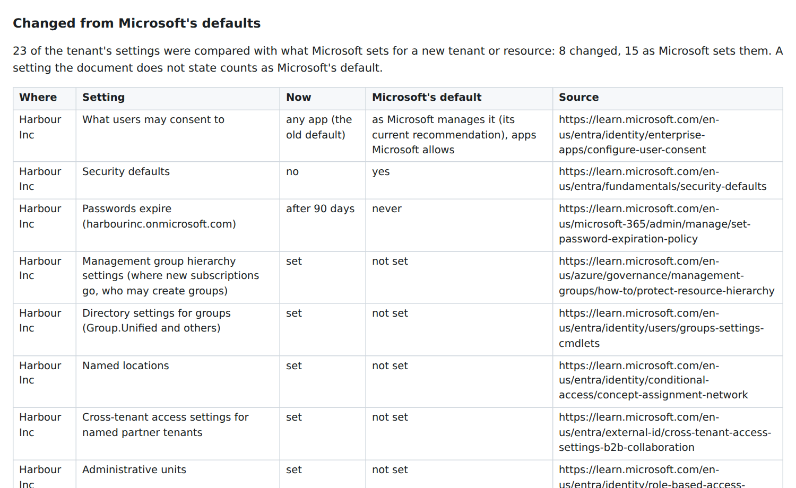
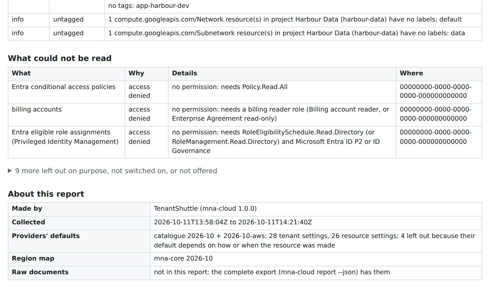
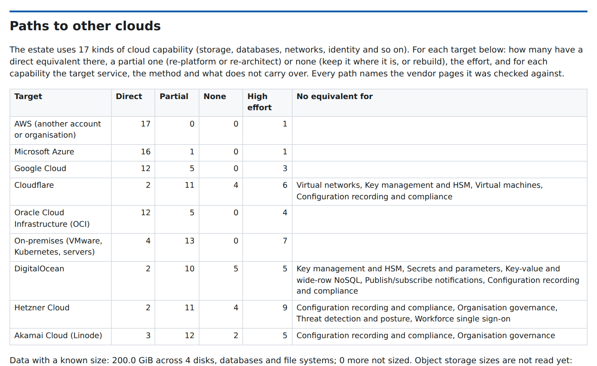
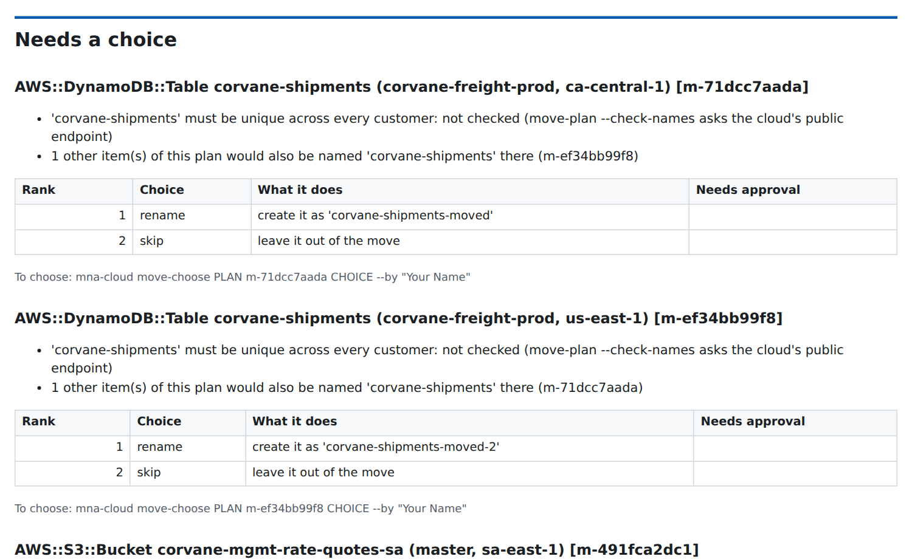

## What it is

When a company is bought, its clouds come with it: tenants, subscriptions and accounts that somebody set up over years, with guardrails, identities, grants, commitments and settings that nobody wrote down. The data room usually lists the main subscription and the systems somebody remembered. TenantShuttle reads what is actually there, so the deal and the integration plan rest on facts rather than a questionnaire.

It reads **Microsoft Azure and Microsoft Entra ID** and **AWS**, every account in an organization and every region it has enabled, with **Google Cloud** read as a preview. It runs on your own computer, as a per-user Windows installer that needs no administrator rights or as a Docker image, and it never sends what it reads, or how it is used, to us. It is available on request from [tenantshuttle.com](https://tenantshuttle.com), and it is one of the [MNA Tools](/work/mna-tools), where it is the inside view of the clouds, from due diligence through integration.

## Asking for access

A look inside someone else's clouds starts with asking for access, and the request is part of the tool. TenantShuttle writes it as a set of scripts the company's own administrators read and run themselves. They ask for read and list permissions only, worked out from the reads TenantShuttle actually makes, so the administrators can see exactly what they are granting and take it back at any time. On Azure, TenantShuttle signs in as an application, preferably with a certificate: the company receives only its public half, and the private key never leaves your computer. On AWS, it takes on a read-only role the company creates in each account, with an external ID.

## Read-only by construction

Every request TenantShuttle sends is first checked against a reviewed allow list of read operations. Anything not on the list is refused on your computer and never reaches the cloud. The list is kept as reviewed text, and the access request asks for exactly the permissions those reads need, so a new read cannot slip in without being reviewed. Each cloud is verified against a lab set up the way a customer's would be: the cloud's own audit log shows no change made by a collection, and no secret planted in the lab appears in any output.

TenantShuttle records configuration, not content. Every document passes through redaction before it is stored (connection strings, keys, tokens, signed URLs, environment-variable values, start-up scripts), and each says what was withheld without keeping the value. Lists that could return a secret value are never asked for at all: on AWS alone that is 45 resource types, each listed with its reason.

## Everything, everywhere

Coverage is the point, so it is generated rather than hand-picked. On AWS, TenantShuttle lists every resource type AWS publishes a list operation for (1,469 of them, generated from AWS's own CloudFormation resource schemas, with the ones that can never be listed named alongside their reasons) in every account and every enabled region. Where those lists can't say enough, it adds AWS Config's records, the tagging API and the services' own reads. AWS Organizations, its units and its policies are read once, from the management account. Spend by service, Savings Plans, reserved capacity, Marketplace agreements and licenses, and the security services switched on are read too. What AWS created by itself, such as its own documents, managed prefix lists and key aliases, is kept apart from what the company built, and each account's defaults are marked as such.

On Azure and Microsoft Entra ID it reads management groups, subscriptions and every resource's configuration; Azure Policy, its assignments and their compliance; tenant settings; users, groups, applications and their permissions, role assignments and credentials with their expiry; licenses, domains and where the data lives.

## The estate report

Everything read becomes one document, in HTML or Markdown, written for a deal team rather than for a cloud engineer. It covers:

- the tenant and its domains and licenses;
- the organization and its guardrails;
- the frameworks the company is measured against;
- who has owner-level access, and who is told when something goes wrong;
- where the data lives and who can reach it;
- every service and how it is set up.

Each part is broken out per tenant, organization, subscription, account and project. Settings changed from each provider's defaults are listed with the value found, the default and the provider's page that documents it.

Every figure comes from what was read. Where something could not be read, the report says so once, and in the right words. A list the access did not allow, a region an organization policy keeps out, a service not offered in a region and a service nobody set up are different things, and the report keeps them apart. Busy services are asked again rather than counted as empty, and nothing is reported as found when it was never read.

Behind the report are a workbook with a sheet per kind of record (accounts, resources, settings, identities, grants, credentials, spend and gaps) and a complete export of every raw document for the engineers. Projects are encrypted: each has its own random 256-bit key, held in the computer's secret store or behind a passphrase, and the complete export and move plans use the same key.

## Paths to other clouds

A target's clouds rarely stay where they are. TenantShuttle names what each service in use does, using 99 cloud-neutral capabilities that cover everything from virtual machines and object storage to workforce sign-on, with every AWS service mapped to one. It then looks each capability up in a catalogue for each of nine destinations:

- AWS (another account or organization)
- Microsoft Azure
- Google Cloud
- Cloudflare
- Oracle Cloud
- DigitalOcean
- Hetzner
- Akamai
- on-premises

For each it gives the offering that does the same job, how well it fits, the approach and the tools, what carries over and what does not, the effort and the downtime. Every path cites the vendor pages it was checked against, and a checker fetches every cited page to make sure it still answers. The estate report adds the readiness, blockers and effort for each destination side by side, flags services the provider is retiring where the estate uses them, and lists the commitments a move must honour, such as reserved capacity, with their end dates.

## What changed

Every collection is a full snapshot with its raw documents, so two collections of the same estate can be compared. TenantShuttle lists what was added, what was removed and what changed, field by field with the value before and after, and which services started or stopped being used. Something the later collection could not read is reported as "not read again", never as removed, and changes that come with use rather than configuration, such as sizes, counts and last-used times, are counted apart. Between signing and closing that answers whether anything the deal relied on has moved; during integration it shows what moved, what was switched off and what appeared.

## The move plan

The costly mistakes in a migration are the silent ones: a name that already existed and was taken over, two things merged that should have stayed apart, a whole account folded into another. TenantShuttle's move plan is built so that none of them can happen without someone saying yes to that one item.

Before anything runs, every name the move would create is checked three ways, using each cloud's own rules for where a name must be unique, its case, its length and the characters it allows:

- **What the destination holds.** The destination is collected read-only, the same way as the source.
- **Names unique across every customer.** Storage bucket names and service addresses belong to the whole cloud, not one account. On request, TenantShuttle asks the cloud's public endpoint whether a proposed name is free, anonymously, and records the answer. A network that blocks the lookup gives "unknown", never "free".
- **The plan itself.** Two sources that would land on one name are caught before either is created.

Each clash comes with ranked fixes, and the person planning the move picks one. The options are a rename by rule (with a suggested name that fits the destination and is checked to be free), another account, subscription, group or region, the object that already exists, or leaving the item out. Renaming the existing object is offered only with its owner's permission. The choice is recorded with who made it and when.

Anything that would overwrite something in the destination, merge into it, or put resources into an account the destination already has is **held**. Approving the whole plan is not enough: a named person approves that item after reading its notice of what exists, what will change and what cannot be undone. For a whole AWS account joining another organization, for example, the notice covers which policies stop and start applying, who pays from then on, and what happens to the account's tags, shares and integrations, with the vendor pages behind each point. Whole accounts are moved, never merged. Approvals can be signed, and an approval whose signature does not verify counts for nothing. Each choice and approval covers the facts it was made on: when the source or the destination changes, the item is asked again instead of running on stale facts.

Building a plan, choosing fixes and approving items change nothing in any cloud. Carrying out moves is in development, one path at a time and starting with a whole AWS account moving into another organization. Each path is proven end to end in a lab before it is offered.

## Built with

Python, the clouds' own SDKs and management APIs, and a project format shared with the other MNA Tools, so the clouds' findings can be read next to the rest of a deal. The test suite runs the real command line against simulated estates of each cloud, and the screenshots on this page show sample data from those test estates, never a real company.
